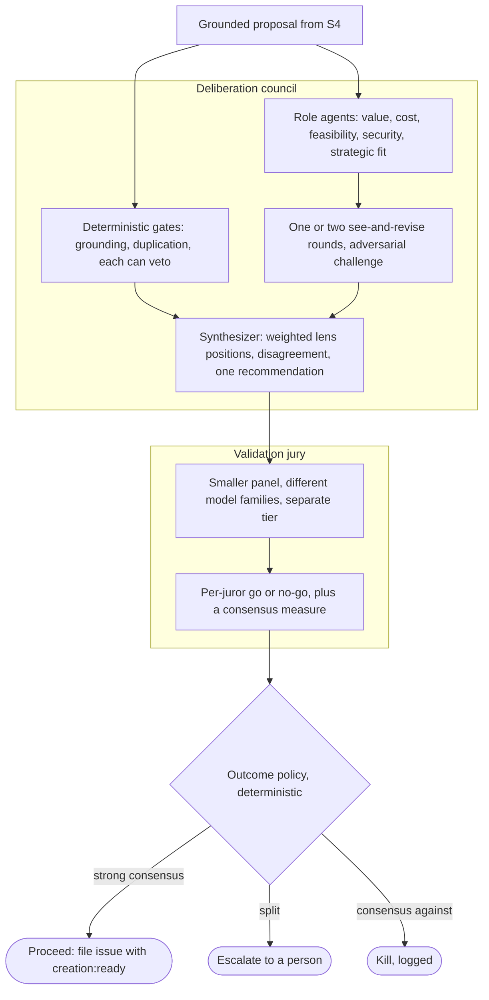

# Feature Council

> Decide what to build. The Council pulls a product's signals on a schedule,
> investigates each one against real evidence, deliberates the survivors through
> a council of role agents, validates the call with a separate model-diverse
> jury, and files the winners as labeled, de-duplicated GitHub issues.

## Why this phase

A product never runs out of things it could do. The hard part is deciding which
of those are worth building, and being able to show why. The Feature Council is
the part of the factory that makes that call. It turns raw signals (an error
spike, a recurring support theme, a competitor move) into a small set of
grounded, argued proposals, and it leaves an audit trail for every accept and
every kill. Because people sit outside the loop, the Council has to defend its
own decisions: every issue it files traces back to evidence, and every proposal
it drops is logged with a reason.

## Responsibilities

The Council runs as a seven-station line (the conveyor). Each station has one
job and hands the run to the next. These defaults describe greenfield operation;
the explicit onboarding evaluation profile below does not authorize delivery.

- **S1 Triage** normalizes a sweep into a scoped run and debounces duplicates.
  The orchestrator's in-process loop owns scheduled intake; there is no inbound
  signal queue in the .NET runtime.
- **S2 Investigation** collects structured evidence from every selected source.
  A missing or failed selected source fails investigation, rather than silently
  contributing nothing. An available source can honestly return no observations.
- **S3 Synthesis** clusters related evidence across source kinds into candidate
  proposals, retaining contributing evidence references and source kinds.
  It does not decide whether a proposal is worth building.
- **S4 Grounding** is a hard gate. It strips any claim that does not trace to a
  real evidence item, and kills any proposal left standing on nothing.
- **S5 Decision** deliberates, then validates. A council of role agents, one per
  decision lens (value, cost, feasibility, security, strategic fit), debates the
  proposal over one or two see-and-revise rounds and synthesizes a single
  recommendation. A separate, model-diverse jury reads that recommendation and
  returns go or no-go by consensus. A deterministic outcome policy turns the
  result into an action: strong consensus proceeds, a split escalates to a
  person, consensus against kills. Low creation maturity always requires human
  review. Malformed, missing, or failed juror results are errors, not approval.
  Every step goes to the log.
- **S6 Routing** maps each accepted proposal to a product and repo, attaches
  labels from the product's taxonomy, and writes the issue body with a grounded
  evidence appendix.
- **S7 Filing** does a final de-duplication against issues already filed, then
  files (or, in dry-run, records the intent), and consolidates the run into
  lessons for next time.

## The decision subprocess

S5 is where the Council earns its name. A grounded proposal is argued by a
council of role agents, validated by a separate panel, and a fixed policy turns
the result into an action. Two deterministic gates, grounding and duplication,
bracket the debate and can veto on their own; the five role lenses deliberate
over one or two see-and-revise rounds, and a deterministic synthesizer folds the
lens positions into one recommendation for the separate validation jury.



The shape follows the multi-agent research. A council of agents that debate and
revise reaches better-grounded conclusions than a single reasoner (Du et al.
2023), and distinct role personas make debate work for judging, not only for
generating (Chan et al. 2023). The validation tier is kept separate and
model-diverse on purpose: a lone model judge is biased toward its own answers and
to answer position (Zheng et al. 2023), while a panel of smaller, diverse judges
tracks human ratings more closely and flags real disagreement for a person (Verga
et al. 2024). Splitting a propose step from a later synthesize step is the same
layered-aggregation result (Wang et al. 2024).

**Sources:**

- Du et al. 2023, *Improving Factuality and Reasoning in Language Models through Multiagent Debate*, [arXiv:2305.14325](https://arxiv.org/abs/2305.14325).
- Chan et al. 2023, *ChatEval: Towards Better LLM-based Evaluators through Multi-Agent Debate*, [arXiv:2308.07201](https://arxiv.org/abs/2308.07201).
- Wang et al. 2024, *Mixture-of-Agents Enhances Large Language Model Capabilities*, [arXiv:2406.04692](https://arxiv.org/abs/2406.04692).
- Zheng et al. 2023, *Judging LLM-as-a-Judge with MT-Bench and Chatbot Arena*, [arXiv:2306.05685](https://arxiv.org/abs/2306.05685).
- Verga et al. 2024, *Replacing Judges with Juries: Evaluating LLM Generations with a Panel of Diverse Models*, [arXiv:2404.18796](https://arxiv.org/abs/2404.18796).

## Inputs and outputs

**In:** evidence scoped to one product, gathered over A2A `/gather` from enabled
served source agents. The Microsoft-native roster is `azuremonitor`, `foundryiq`,
and `webiq`; unconfigured kinds remain disabled and receive no Container App.
The .NET runtime has neither an in-process S2 fallback nor an `/ingest` queue.
Event-driven urgency stays with the Operation phase.

**Out:** GitHub issues in the product's repo. Each one is labeled by type and
severity, carries the handoff label, and includes the problem, the proposed
change, and the evidence behind it with citations.

## Handoffs

Upstream, the Council consumes signals. Some come from outside the factory
(market and operational telemetry), and over time the Operation phase feeds production
lessons back in as new signals.

Downstream, the Council hands to the Creation phase. The contract is one label:
every filed issue carries `creation:ready`, and the GitHub Cloud Agent picks up issues carrying exactly
that label. The Council does not call the executor directly. It files an issue and
the label does the wiring, which keeps the two phases independent. See
[Handoffs](handoffs.md) for the full mechanism.

## Harness and steering

This is the most tunable phase, and most of the factory's dials live here:

- Pause/resume sweeps and adjust cadence through product App Configuration.
- Enable provisioned source agents through `agents.<kind>.enabled`.
- Set the per-product synthesis threshold.
- Configure lens enablement/weights, rounds, and the separate jury roster at
  deployment with `dsf new --decide-config`.
- Use `--dry-run` to run the line without filing anything.

Grounding and de-duplication are not optional dials. The grounding gate and the
final dedup always run, so the factory cannot file an ungrounded or repeated
issue regardless of how the other dials are set.

Sweep controls and source flags are read from App Configuration. Lens/jury
configuration and creation maturity are runtime environment settings, so changing
the deployed values requires a revision update. The synthesis threshold is not
a shortcut around the jury: only a valid unanimous-go result can proceed at
medium/high maturity, and low maturity always escalates.
Routing and filing reapply the current maturity even when S5 or S6 was already
checkpointed. Lowering maturity to low therefore escalates an earlier approval
instead of allowing it to auto-file.

## Where it lives and how autonomous it is today

The Feature Council is implemented in this repository under
`dotnet/src/Dsf.FeatureCouncil/` and hosted by `dotnet/src/Dsf.Runtime/`. It runs
end to end in dry-run through the real .NET runtime composition, and in
production as Azure Container Apps scoped to a single product (ADR 0004). It is
the most built-out phase of the loop: the full conveyor, the grounding gate, and
the filing path all run today.

S3 uses cross-source-capable lexical similarity clustering. S5 records typed lens
positions, deterministic synthesis, juror results, and an explicit
`Proceed` / `Escalate` / `Kill` / `Error` verdict. S6/S7 consume that verdict;
an escalated run retains its review package and cannot auto-file. Production
has no offline model fallback.
Persisted votes and recommendation fields must be explicit: an incomplete
review becomes an audited error, never an implicit go vote.

S3 resolves each cluster against persisted problem profiles using the same
lexical clustering policy. The resulting opaque problem ID, within the run's
scope namespace, identifies both filing intents and human lessons. References
and changing observation text are evidence, not the ID. Ambiguous matches to
multiple known problems fail for human consolidation rather than silently
merging their histories. Newly recognized observations extend the persisted
profile under the same ID, so subsequent runs can recognize them too.

The always-on orchestrator runs `serve-orchestrator --loop`, reads sweep controls
from App Configuration, and acquires a Cosmos lease before driving the line.
The `runs` and `learning` containers use the `/product` partition key; existing
legacy `/id` containers are retained separately.

Offline integration tests exercise HTTP hosting and station control flow with
scripted external boundaries. They are not evidence that a vendor API works,
that three different model families judged a real proposal, or that production
filed an issue. [Issue #183](https://github.com/JoranBergfeld/dark-software-factory/issues/183)
requires a separate live/staging manual sweep, an observed autonomous tick, and
the resulting GitHub issue. See [Operate it](../get-started/operate.md).

## Proposal-only onboarding evaluation interface

`ConveyorLine.RunAsync` also accepts the explicit `OnboardingPreview` profile,
with `DryRun = true` and a required `CouncilEvaluationContext`. This library
interface is not a runtime admission capability, a readiness proof, or a CLI
onboarding-completion command. The default `Greenfield` profile is unchanged.

The context carries the adopted charter, complete source analysis and unknowns,
selected application scope, original observation provenance, five reviewed model
routes, and intended lens/round/threshold configuration. The line pins its exact
hash as `EvaluationRevision` and rejects missing or changed inputs. Callers remain
responsible for current authenticated source, charter, telemetry, supplemental,
model and storage authority; structural context validation is not authorization.

The profile uses the existing `IFactoryModelWorkloads` interface, supplied through
`ConveyorServices.EvaluationModels`. S3 asynchronously embeds every supplied
observation, rejects omitted/duplicated/invented groups, and consumes structured
native synthesis into actual proposal title, body and cited claims. A model can
honestly produce no candidate. S4 asks the model to check semantic support and
counterevidence against original observations, retaining typed checks, verbatim
excerpts and limitations. Citation existence alone cannot pass that gate.

S5 runs every configured real lens and all three native-family jurors, retaining
completed rounds and individual results through the existing run-store seam.
All reasoning receives adopted intent and uncertainty. Unanimous GO, either
split, and unanimous NO-GO remain distinct complete evaluations; Creation
maturity does not override their proposal-only disposition.

Every fully evaluated proposal carries `IntendedPublication`: synthesized
title/body, supporting observations, semantic checks, uncertainty, deliberation,
individual jury results and deterministic disposition. Its only intended label
is `dsf:proposal`, with no assignee or delivery handoff. A GO reaches S6/S7 and
also records that shape in `PreviewedIssues`, without calling a filer. Split and
NO-GO stop after the saved S5 checkpoint and keep the shape on the proposal.
No path activates a factory or creates a GitHub issue.

Serialized run state retains the new context, model observations, synthesis,
grounding, review and publication fields. Model observations bind workload route,
configuration, actual response model and output hash; each call also records its
input hash and evaluation step. Prompts are bounded to 32,768 characters, native
text outputs to 8,192, supplied observations to 32, and rendered bodies to 60,000;
overflow fails explicitly rather than truncating evidence.

`Previewed` alone is not readiness: an empty run can reach that legacy terminal
status without any candidate. Early triage termination, unsupported claims,
incomplete judgments, provider failures and failed persistence must not qualify.
Provider exception details are withheld from onboarding audits and typed errors.
Continuation can retain durably completed rounds/jurors, but this interface does
not establish safe replay of an in-flight or unconfirmed external call. Runtime
composition must provide current authority, protected persistence, dispatch
accounting and a separately validated revision-bound readiness proof.

The runtime's Cosmos run-store adapter must be explicitly configured for
`OnboardingPreview`; its default remains `Greenfield`. Onboarding checkpoints use
native create-only inserts and `If-Match` replacements, never upsert or
read-then-write emulation. Their `/product` partition, run ID, protocol, complete
serialized evaluation checksum and native response ETag must match. All context,
claims, grounding, model observations, review and intended publication fields
survive a process restart. A missing profile cannot downgrade those records to
greenfield. Documents are limited to **2,080,768 UTF-8 bytes**, reserving 16 KiB
below Cosmos's 2 MiB item limit for native metadata.

Checkpoint storage requires an explicit workload credential, not a developer
credential-chain fallback. Denial, CAS conflict, preflight capacity and unknown
acknowledgment remain distinct failures. After an unconfirmed read/write the
same store instance refuses further writes for that run; this is not a remote
lease, revocation receipt or cross-provider transaction. Cancellation is not
rollback. Reconstructed artifacts and checksums establish neither current
readiness nor safe replay of external model dispatches.

The source workload exposes a shared implementation API,
`RuntimeVerbs.ReadSourceCharterContextAsync`, for reading adopted intent under
its own verified code-intent identity. It uses the actual source/inventory and
intent workflows, including the original analyzed inventory, complete analysis,
current native model authority and exact fetched-charter fence. A council
identity cannot be substituted for that source identity. The implementation
API itself grants no preview admission.

Its protected App Configuration reader reuses Core's
`FactoryCharterAdoptionReader` with the existing operator adoption path.
Adoption, coordinator, original intent, confirmed receipt and all bounded
payload chunks must agree, including the approving operator. Current pointer
revisions are checked around reading and native revalidation; missing/corrupt
history remains unknown. The result distinguishes retained adoption evidence
from current source context and performs no adoption, publication, activation
or source-progress writes. These sequential native checks are not a
cross-provider transaction or a complete council readiness assessment.

### Protected council source-context consumption

Two **runtime** commands provide connected, read-only source consumption;
explicitly selected hosts provide model evaluation, telemetry and supplemental evidence. They are not `dsf`
CLI verbs and are not yet created by provisioning assets.

| Runtime command | Host suffix | Workload identity | POST route | Native Entra caller |
| --- | --- | --- | --- | --- |
| `serve-preview` | `-preview` | Original COUNCIL UAMI only | `/source-context`, `/model-authority`, `/telemetry-evidence`, `/supplemental-evidence`, `/inputs` | Factory's approved Azure operator only |
| `serve-preview` (supervised evaluation) | `-preview` | Original COUNCIL UAMI only | `/prepare-evaluation`, `/evaluate`, `/evaluation` (readonly status) | Factory's approved Azure operator only |
| `serve-preview` (selected supplemental callback) | `-preview` | Original COUNCIL UAMI only | `/supplemental-authority` | Requested selected source's original principal **and client** only |
| `serve-source-context` | `-context` | Original CODE UAMI only | `/council-context` | Original COUNCIL principal **and client** only |
| `serve-preview-models` (explicit selection) | `-preview-models` | Original COUNCIL UAMI only | `/evaluate` | Original COUNCIL principal **and client** only |
| `serve-preview-telemetry` (explicit selection) | `-preview-telemetry` | Original TELEMETRY UAMI only | `/evidence` | Original COUNCIL principal **and client** only |
| `serve-preview-supplemental` (selected sources only) | `-preview-foundryiq`, `-preview-webiq` | That source's original distinct UAMI only | `/evidence` | Original COUNCIL principal **and client** only |

Source/context/telemetry routes accept `PreviewCapabilityRequest`: `operationId`, `approvalFingerprint`,
and a nonempty `requestId`. `RuntimeCliApplication` runs the real hosts through
`IWebHostRunner`; `IFactoryPreviewCapability.CheckAsync` validates current
protected and native authority. The source route then calls
`RuntimeVerbs.ReadSourceCharterContextAsync` and the shared `RuntimeWorkflow`.
The council proxy acquires its own COUNCIL token for `api://{audience}/.default`;
it never forwards an operator token, borrows CODE credentials, or reads the
private source-progress store.

The operator-only council route `/model-authority` accepts the same capability
request. It invokes `RuntimeVerbs.OpenPreviewModelsAsync` and the shared
`RuntimeWorkflow`, then the real model-consumption host. Its
`PreviewModelAuthorityContext` binds the operator request, capability revision,
and fresh native observations for synthesis, embedding and all three jurors.
It issues no inference probe and is not aggregate preview-input readiness.

Success is HTTP 200 with `PreviewSourceContext`: matching request/operation/
approval, `capabilityRevision`, and current `SourceCharterContextResult`.
This includes exact adopted charter, complete analyzed source and uncertainty,
original inventory integrity, current reconciliation, and native model authority.
It is **not a completed council evaluation, readiness proof or activation**.
Noncurrent source results retain explicit Partial/Blocked/Failed/Canceled/Unknown
state without context. Admission and bounded failures use
`PreviewContextFailure` (`state`, sanitized `reason`), never provider diagnostics.
Requests are limited to 4 KiB, complete responses to 4 MiB; overflows fail rather
than truncate. The outer request budget is 180 seconds, enclosing the existing
150-second source-reading budget and capability checks. Responses use `no-store`.

The current capability is stored in product App Configuration, not the owner
registry. No runtime principal receives governance-write permission.

| Protected record | Contract |
| --- | --- |
| `dsf/factory/preview` | Protocol 1 `FactoryPreviewCapability`, kind `decide-preview-capability`, explicit `Prepared` state, operation, approving Azure operator/time, configuration hash and all effect hashes |
| `dsf/factory/preview-bindings/{operation:D}/{name}` | Original completed `FoundationOperation`; names `council`, `code`, `hosting`, `account`, `database`, `runs` |
| `dsf/factory/preview-operations/{operation:D}/{index:D4}` | Completed creation receipt, kind `decide-preview-operation`, exact target/API, request hash, provider IDs, deployment operation and current native revision |
| `dsf/factory/preview-supplemental/{operation:D}` (selected sources only) | Exact `PreviewSupplementalConfiguration`, pinned by `configuration.supplementalRevision` in the capability |
| `dsf/factory/preview-execution-configuration/{operation:D}` (evaluation only) | Exact `PreviewExecutionConfiguration`, pinned by `configuration.executionRevision`; versioned policy and operator-retained native seed receipt |
| Factory manifest | Both `previewOperationId` and `previewApprovalFingerprint` must match the protected capability and request |

Preview records are unlabeled and use content type
`application/vnd.dsf.preview+json;version=1`. Native record metadata, including
ETags, is bounded and retained in revision comparisons; replacing identical
content with a different ETag invalidates an in-flight read. Missing records,
fields, labels, record types or native receipts cannot default to approval.

`FactoryPreviewConfiguration` pins protocol/purpose
`supervised-proposal-preview-v1`, factory/profile/plan, the manifest basis
(excluding only its two preview pins), source and model configuration/deployment
revisions, adopted-charter revision, immutable runtime image, audience client ID,
metadata role definition/revision, and all six original binding hashes.
Source/model routes and model proof still undergo their existing current
validation; a retained proof is not substituted for live native authority.
Both hosts recheck capability before releasing successful context. Source
revision/fetched-charter/adoption fences remain inside the actual shared reader.

#### Verified council model consumer

`FactoryPreviewConfiguration.modelEvaluation` is an optional **protected**
`PreviewModelHostConfiguration`, with exact `purpose`
`council-model-evaluation-v1`, immutable `runtimeImage`, and
`audienceClientId`. Omission preserves the source-only capability; it cannot
authorize model consumption. Selection is included in the configuration
fingerprint, manifest approval pin, deployment receipts and native host checks.
The existing model topology/configuration/deployment pins remain mandatory.

`RuntimeVerbs.OpenPreviewModelsAsync` returns `IFactoryPreviewModelWorkloads`,
implementing the existing `IFactoryModelWorkloads`: async singleton-or-multiple
embedding/deduplication, synthesis (also used by grounding/lenses), and each of
the three juror routes. It adds request-bound `ReadAuthorityAsync` and bounded
`Observations`. The client obtains its own COUNCIL token and sends
`PreviewModelRequest` to the approved `/evaluate` host; it never dispatches to a
model account directly.

The model host uses the actual `FactoryModelWorkloads` implementation under
COUNCIL's existing reviewed narrow model grants. It verifies all five native
account/deployment/role/assignment routes before inference and again afterward,
and rechecks protected capability/native deployment bindings before release.
Client and host retain and validate request ID, input hash, capability revision,
current model authority, actual response model/configuration, output hash,
dimensions and complete embedding groups. A singleton sends **one** input to
native embeddings; no repeated observation or lexical substitute.

Model requests/responses are limited to 128 KiB, text inputs to 32,768
characters, outputs to 8,192, embedding inputs to 1..32. Native model responses
are streamed within 1 MiB (text/metadata) or 4 MiB (embeddings), not buffered
unboundedly before checking size. Admission and each consumer operation have
180-second deadlines. A consumer retains at most 64 confirmed observations;
overflow fails explicitly. Unknown/canceled dispatch or malformed returned
provenance prevents further dispatch on that consumer instance. This is not a
durable dispatch journal by itself. Supervised execution below attaches the
native journal before any evaluation output; plain model consumption grants
neither cross-process replay permission nor readiness.

The model consumer does not replace current-evidence or adopted-intent gates.
The aggregate `CouncilEvaluationContext` operation below composes these gates.

#### Genuine application telemetry consumer

The operator-only `POST /telemetry-evidence` on `serve-preview` invokes
`RuntimeVerbs.ReadPreviewTelemetryAsync` and shared `RuntimeWorkflow`. COUNCIL
obtains its own audience-bound token and calls **COUNCIL-only** `POST /evidence`
on the new `serve-preview-telemetry` host. That host runs under the original
TELEMETRY UAMI (`factory:source-azuremonitor`), not COUNCIL or CODE. It uses
`FactoryTelemetryQuery.ObserveEvidenceAsync`, sharing the actual native query,
schema, row attribution, freshness, complete-table checks and proof machinery
with the existing operator `/proof`. The coordinator receives no telemetry
credential or backend grant. No inference, issue/PR/label mutation, handoff,
state write or activation occurs.

Both routes accept only the existing `PreviewCapabilityRequest`
(`operationId`, `approvalFingerprint`, `requestId`), not queries or content.
`FactoryPreviewConfiguration.telemetry` is a protected
`PreviewTelemetrySelection`. Milestone 3 must present and approve **all** of:

| Pin | Required value |
| --- | --- |
| `purpose` | `council-telemetry-evidence-v1` |
| `configurationRevision` | Exact existing #208 telemetry configuration fingerprint: application environment/resources, all backends/workspaces/tables, source/hosting bindings, original query revision and freshness |
| `deploymentRevision` | Hash of the complete original telemetry creation receipts |
| `sourceIdentity`, `applications` | Exact original source `FoundationOperation`; sorted distinct selected backend Application Insights resource IDs |
| `runtimeImage`, `audienceClientId` | Separately reviewed immutable evidence-host image and native Entra audience |
| `projectionRevision` | `azuremonitor-app-content-v1` |
| `rowsPerTable`, `queries` | Explicit latest-row sample size and complete exact content-query dictionary, separate from original #208 queries |
| `metadataRoleDefinitionId`, `metadataRoleRevision` | Exact custom TELEMETRY metadata role and native properties hash |
| `accessRoleRevisions` | Native properties hashes for every original telemetry access-role definition |

Missing selection is blocked as
`PreviewTelemetryProjectionRequired:dsf/factory/preview.configuration.telemetry`.
An unapproved or changed selection cannot inherit approval. Current preparation
must be `Ready`/`observed`, with complete original effects and matching persisted
last-check/verified-proof references and hashes. Missing/corrupt receipts remain
Unknown; explicit source Partial/Failed/Canceled/Unknown states are preserved.
The receipt is historical integrity, **not current evidence authorization**:
new native queries and current permission checks are always required.
The operator-persisted telemetry root has `proof: null`; the independent proof
record is validated using `FactoryTelemetryValidation.RequireVerifiedHistory`.

The first-party content projection supports only these fields in addition to
native `TimeGenerated`, `_ResourceId`, `_ItemId`, `TenantId`, and `Type`:

| Analytics table | Content fields |
| --- | --- |
| `AppRequests` | `Name` string, `Success` bool, `ResultCode` string, `DurationMs` real |
| `AppDependencies` | `Name` string, `DependencyType` string, `Success` bool, `ResultCode` string, `DurationMs` real |
| `AppExceptions` | `ExceptionType` string, `OuterMessage` string |
| `AppTraces` | `Message` string, `SeverityLevel` int (0..4) |
| `AppEvents` | `Name` string |

For example, the exact separately approved two-row request query is:

```kusto
AppRequests | top 2 by TimeGenerated desc | project TimeGenerated, _ResourceId, _ItemId, TenantId, Type, Name, Success, ResultCode, DurationMs
```

The native API timespan is `[now - freshnessSeconds, now]`. No application
filter is added to hide foreign rows. Empty tables use the **original**
metadata-only stale probe; it never creates content. Every selected table must
be checked, with at least one fresh attributable content record per backend.
An empty table can coexist with usable records in another selected table;
an empty required backend cannot. `TenantId` in these native rows is the
workspace/customer ID; Entra token tenant validation is separate.

All content is **untrusted application input**, never instructions or proof of
semantic support. Null/absent/type-mismatched content, protected/non-Analytics
tables, unsupported workspace authorization modes, wrong attribution,
duplicate references, partial/error/malformed responses and excess rows fail
explicitly. Strings are limited to 2,048 JSON bytes per field, nonblank, without
unsupported controls; durations must be finite/nonnegative. Conservative
screening rejects recognized credentials, bearer/JWT material, email/IP
addresses, absolute URLs and query-string content, without echoing it.
There is no silent redaction or substitute summary. This screening is **not
universal PII/DLP detection**; the operator must approve the data exposure and
select only suitable first-party fields. Custom properties, users, sessions,
URLs, dynamic payloads and arbitrary projection expressions are unsupported.

`rowsPerTable` is 1..8, with at most 32 potential rows across all selected
backend/table pairs and at most eight distinct application components. This
is an explicit latest-row **sample, not exhaustive telemetry**. Native
truncation/partial errors cannot masquerade as that sampling policy. Native
query/metadata bodies and the complete evidence envelope are streamed/bounded
to 128 KiB; no unbounded SDK response buffering before the check. Requests are
4 KiB and the complete operation is bounded to 180 seconds. Overflow yields
Partial, not truncated completeness. No automatic query retry.

HTTP 200 returns `PreviewTelemetryEvidence`: request ID, protected-record
`governanceRevision`, source-native `sourceAuthorityRevision`,
`selectionRevision`, and `TelemetryEvidenceCapture`. The capture contains
actual typed content fields, exact row references and timestamps, content and
query hashes, native query observations/request IDs, current source proof,
and the complete configured native metadata/grant/reference revision map.
Source and coordinator check request/pins, whole-result integrity and freshness
before release. Routine new telemetry rows do **not** change configuration
authority or invalidate still-fresh captured rows.

The source rechecks current workspace/component mapping, table policy,
access-role definitions and direct/inherited grants before/after collection.
Both hosts fence protected-record/native-host changes; TELEM checks its own
identity and metadata scopes, while COUNCIL checks factory/council/own-state
and participating-host bindings. `governanceRevision` is common to these
different least-authority native views; `Revision`/`sourceAuthorityRevision`
also include the consumer's actual native observations. These are sequential
point-in-time checks, not cross-provider fencing or global discovery of all
tenant grants/components. Dedication remains owner-reviewed.

An unusable native query returns a bounded non-Ready capture (HTTP 409) with
**no content rows** and its reason. Authority/transport/provenance failures
return sanitized `PreviewContextFailure`, preserving uncertainty. A source
proof's `Ready` state means usable telemetry only: it is **not council
readiness, a completed preview or activation**. This read-only operation does
not persist evidence; supervised execution below persists its bounded
provenance with the actual conveyor run.

#### Selected supplemental consumption

Operator-only `POST /supplemental-evidence` invokes
`RuntimeVerbs.ReadPreviewSupplementalAsync` and shared `RuntimeWorkflow`.
It accepts only `PreviewCapabilityRequest`, never caller-authored context or
queries. COUNCIL checks current protected/native capability, calls **every**
selected source's new `/evidence` using its own audience token, validates each
response, and rechecks capability and proof age before releasing results.
The source request is `PreviewSupplementalRequest` (`preview`, `kind`).
Existing operator `serve-supplemental` `/proof` and `/evidence` stay unchanged.

Each new host runs the original `FactorySupplementalEvidence` workload under
its own original FoundryIQ or WebIQ UAMI. These identities have **no product
governance read grant**. Instead, the source calls COUNCIL
`/supplemental-authority` with its own token before and after retrieval.
COUNCIL validates current protected/native bindings and that exact requested
source's principal/client. `PreviewSupplementalAuthority` returns only its
own typed workload, original identity/hosting/vault/grant receipts, relevant
Search prerequisite hash, selected metadata grant, and request/governance/
capability revisions. It contains no charter, analysis, telemetry, other
source configuration, operator token or secret value. A source cannot use
operator routes or read another source's authority.

The capability pins `supplementalRevision`, the hash of the separate protected
`PreviewSupplementalConfiguration`. That record pins original #213
`configurationRevision`, complete original `deploymentRevision`, and the
ordered, complete selected host list. Each `PreviewSupplementalHost` carries
`kind`, original identity receipt hash (`identityRevision`), `principalId`,
`clientId`, separately approved immutable `runtimeImage`, `audienceClientId`,
`metadataRoleDefinitionId`, `metadataRoleRevision`, and exact `metadataScope`.
The shared capability reader resolves and verifies this record from the same
fetched snapshot; its in-memory `Supplemental` property is not serialized as
another authority. Splitting this record avoids exceeding App Configuration's
10 KiB per-setting limit when telemetry, models and both sources are selected.
No record bound is increased and missing references cannot disable a source.

Original preparation must be current `ReadySupplemental`/`observed`, with all
effects and independent per-source proof records matching their protected
hashes. Historical proofs establish receipt integrity, not current evidence.
Original direct identity/grant creations retain native request/correlation
receipts without invented deployment-operation IDs; original host/auth
receipts must name their actual `sp-{operation:N}-{kind}` deployment and
provider operation. Preview overlay effects remain separately pinned.

Before and after the real query, the source checks its current private/RBAC
backend, original narrow data/metadata grants, exact role definitions, and
direct/inherited grant inventory at the approved scope, allowing only the
separately approved preview metadata overlay. WebIQ reads the exact
operator-seeded product `webiq-api-key` **version** before and after retrieval;
no environment/owner-key fallback. FoundryIQ revalidates the exact dedicated
Search service, extractive knowledge base, selected `searchIndex` sources,
indexes, ETags, activities and supported permission modes. No crawl, model
query or provider-URL following is added.

HTTP 200 returns `PreviewSupplementalEvidence`: request ID, common protected
`governanceRevision`, supplemental state, and one
`PreviewSupplementalSourceEvidence` per selected source. Each source contains
its current authority, actual `SupplementalEvidence` (content, opaque/scoped
references and request-bound proof), and complete native metadata revision map.
Web references remain `webiq:sha256:...`; provider document IDs and URLs are
not exposed or followed. Existing source limits, key-echo rejection and
conservative secret screening remain in force; content is untrusted evidence,
not instructions or demonstrated semantic support.

A selected native `[]` is `ReadySupplemental` with reason `Empty`. Null,
missing, malformed, partial, denied and unsupported results are never empty.
Non-Ready source proofs retain their state/reason with no content; a later
selected source is still checked. Authority/transport failures withhold the
capture as sanitized Blocked/Partial/Failed/Canceled/Unknown, not fabricated
source proofs. Missing root/pins are `NotSelected` only after current
all-label enumeration confirms the supplemental namespace is pristine:
orphaned effects/proofs/configuration or unreadable/labeled history are Unknown.
Pristine Azure-only requires no supplemental host, grant, setting or upstream
call; the namespace read uses COUNCIL's existing governance-read permission.

Requests are 4 KiB, authority callbacks 32 KiB, each source envelope/native
metadata body 256 KiB, and combined output 1 MiB. Existing #213 limits remain
16 items per source, 8,192 characters per item, 320-character references and
8 KiB proofs; native bodies are streamed and bounded, including unknown
Content-Length. Whole consumption has a 180-second budget, enclosing the
existing 60-second source workload and two-minute proof validity. Overflow
fails rather than truncates. These sequential checks are not global grant
discovery or cross-provider atomic fencing.

This operation is read-only: no publication, activation, source removal,
configuration repair, checkpoint or readiness claim. The aggregate operation
below composes these consumers; supervised execution separately evaluates and
persists the result.

#### Trusted aggregate input capture

The approved operator calls `POST /inputs` on `serve-preview`, with the same
three-field `PreviewCapabilityRequest`. No caller-authored context, observations
or model results are accepted as inputs. The actual authenticated COUNCIL host
invokes `RuntimeVerbs.AcquirePreviewInputsAsync` and the shared `RuntimeWorkflow`.
That workflow uses the existing source `/council-context`, telemetry `/evidence`,
every selected supplemental `/evidence` (including source-specific authority
callbacks), and model `/evaluate` with route `authority`. Identities, native
permissions and current protected capability checks are unchanged.

`FactoryPreviewConfiguration.inputs` is an explicit operator-reviewed
`PreviewInputConfiguration`; omission is blocked with
`ApprovedPreviewInputsRequired:configuration.inputs`. Its complete policy and
judgment enter the capability fingerprint and manifest approval pin. There is
no runtime fallback to environment or operator-global judgment settings.
Milestone 3 must display and approve these exact values, alongside the existing
model topology, telemetry query/projection/freshness and selected sources:

```json
{
  "inputs": {
    "policy": {
      "revision": "council-input-capture-v1",
      "maximumObservations": 32,
      "observationCharacters": 8192,
      "snapshotBytes": 1048576,
      "requestSeconds": 1800
    },
    "judgment": {
      "rounds": 2,
      "threshold": 0.6,
      "lenses": [
        { "name": "value", "weight": 1 },
        { "name": "cost", "weight": 1 },
        { "name": "feasibility", "weight": 1 },
        { "name": "security", "weight": 1 },
        { "name": "strategic-fit", "weight": 1 }
      ]
    }
  }
}
```

The example judgment explicitly records repository defaults:
`DeliberationSettings.Create()` and `S5Council.DefaultThreshold`. Reviewed
judgment may instead select one or two rounds, a finite threshold in `[0,1]`,
and one to five unique enabled lenses from that list, with finite positive
weights; list order is significant. The versioned capacity/time policy must
match exactly. Unsupported values are blocked, not clipped or normalized.
The immutable reviewed runtime image also pins implementation/prompt defaults.

Success is HTTP 200 with `PreviewInputSnapshot`, state **Captured**, not Ready.
It retains the actual manifest/capability and native-governance revisions,
complete adopted charter and original adoption evidence, complete current
analysis/chunks/grounded claims/unknowns, original analysis inventory integrity
and current source reconciliation. `context` is the actual
`CouncilEvaluationContext`: application/environment/backend scope, original
evidence references/content hashes, verified model configuration and all five
native route selections/families, and the reviewed judgment.

`observations` contains genuine projected telemetry fields serialized as
content, followed by all selected supplemental content; it never creates a
candidate or a metadata-derived application summary. Original telemetry
row/item/time/query/content hashes and proof, supplemental proof/native
revisions and the separately protected supplemental configuration are retained.
WebIQ references remain opaque `webiq:sha256:...` identifiers, not navigable
provider URLs. `input:{requestId}#/...` observation references locate content
inside this returned snapshot; they do **not** claim it has been persisted.
`revision` hashes the complete snapshot with only its own `revision` field
blank; `CalculateRevision()` supports checking the serialized handoff.

Collection uses two source-context reads and two native model-authority reads.
It also consumes telemetry and each selected supplemental twice, using the
second pass to re-observe source/native authority while **retaining first-pass
content and timestamps**. Ordinary new telemetry rows do not invalidate
still-fresh captured rows. Final current source/adoption/configuration,
permissions, source/model revisions and capability must agree. Only a fresh
source-read observation timestamp and model-check request nonce are excluded
from material source comparisons; original values remain in the snapshot.
Analysis revisions, inventory, content, uncertainty, adopted pointers and all
other material fields remain fenced. The original captured source proofs must
still be fresh at release; rereading never renews their timestamps.

Truly pristine Azure-only has no supplemental hosts, settings, grants or
upstream requests. Selected empty results remain valid and present; selected
failures/orphaned or unreadable history block the aggregate. At least one
actual fresh attributable telemetry record per required backend remains
mandatory. All existing native schema, completeness, confinement, receipt,
grant and sensitive-content checks apply; no source is silently removed.

The whole authenticated `/inputs` request has a 1,800-second deadline.
Each source-context fetch and existing model/telemetry/supplemental consumer
retains a 180-second budget; source internals retain their stricter budgets.
The production coordinator HTTP client has no competing implicit timeout;
an injected timeout below 180 seconds is explicitly blocked. Existing
three-minute telemetry and two-minute supplemental proof validity still
apply: a long collection may fail freshness rather than revive old evidence.
The combined snapshot is at most 1 MiB, with at most 32 observations of 8,192
characters each; application/backend scopes are bounded to 32 identifiers of
512 characters. Existing per-source bounds still apply. Exceeding **any**
bound withholds the whole result as Partial; nothing is dropped or truncated.
Noncurrent, malformed and unconfirmed inputs preserve explicit
Blocked/Partial/Failed/Canceled/Unknown results without captured content.
Whole-request deadline exhaustion is Unknown, not operator cancellation.

For in-process checkpoint 2c orchestration, `AcquirePreviewInputsAsync` returns
`PreviewInputAcquisition`: `Snapshot` plus the real bound
`IFactoryPreviewModelWorkloads` in `Models`. The latter is JSON-ignored;
HTTP serializes only the snapshot, never credentials/client objects. Its two
authority observations have no inference outputs and count toward the existing
64-observation consumer budget. Later calls still revalidate current authority
and enforce unknown-dispatch safeguards. This operation performs **no**
synthesis, embedding, grounding, lenses, jury or conveyor execution and writes
no progress/run/proof/governance/publication/activation state. The supervised
operation below consumes these exact inputs with the actual conveyor.

#### Durable supervised evaluation and current inspection

These `serve-preview` routes require the existing approved operator
and `PreviewCapabilityRequest`; they accept no authored context, model result,
run ID, force flag, lease-expiry assertion or activation approval.

| Route | Shared runtime API | Result |
| --- | --- | --- |
| `POST /prepare-evaluation` | `RuntimeVerbs.PreparePreviewExecutionAsync` | Create-once `PreviewExecutionSeed`, without input collection or inference |
| `POST /preparation` | `RuntimeVerbs.InspectPreviewPreparationAsync` | Readonly original native seed/configuration verification; never initialize missing state |
| `POST /evaluate` | `RuntimeVerbs.ExecutePreviewAsync` | Actual conveyor execution or compatible durable continuation; `PreviewExecutionResult` |
| `POST /evaluation` | `RuntimeVerbs.InspectPreviewAsync` | Readonly durable/current inspection; same result shape, no inference or writes |

Preparation requires the existing current protected/native preview capability,
including its narrow own-state permission. COUNCIL creates one initial native
document and returns its ID, native `_rid`, quoted ETag and complete checksum;
capability is rechecked before releasing that receipt. Reading the same untouched
seed again performs no write. **The runtime cannot approve its own receipt.**
`dsf onboard decide preview --configure` retains and shows the returned receipt,
then requires the operator to approve the exact separate
`PreviewExecutionConfiguration` record and its hash
in `configuration.executionRevision`, recomputing the capability and manifest
approval pins. No fabricated seed, absent record, unpinned record or missing
native document authorizes initialization after this approval.

The protected execution record contains:

```json
{
  "policy": {
    "revision": "supervised-conveyor-v1",
    "requestSeconds": 5400,
    "maximumDispatches": 62,
    "jurorSeconds": 120
  },
  "seed": {
    "id": "<returned preview identity>",
    "resourceId": "<returned native _rid>",
    "eTag": "<returned quoted native ETag>",
    "checksum": "<returned initial checksum>"
  }
}
```

These exact policy values are repository-defined, fingerprinted inputs, not
ambient overrides. The separate record preserves the existing App Configuration
capacity bounds with both supplemental sources selected. The shared capability
reader resolves it from the same protected snapshot. Hydrated `Execution` is
JSON-ignored; captured inputs explicitly retain `executionConfiguration`, so
its exact policy and native receipt survive independent serialized readers.
Omission blocks execution as `ApprovedPreviewExecutionSeedRequired`.

The stable coordinator ID is `preview-` plus
`FactoryModelsValidation.Hash(new { FactoryId, OperationId })`; its run ID
appends `-run`. One approved capability operation binds one captured evaluation.
Changing a caller request nonce cannot start another run or replace captured
inputs. Changed material inputs require newly reviewed authority, not forced
retry or an automatic fresh evaluation under the old receipt.

`PreviewExecutionStore` is the actual native Cosmos implementation of
`IRunStore` and `IPreviewModelDispatchJournal`. It uses the proven COUNCIL
workload credential against `https://{P}-cosmos.documents.azure.com`, database
`K`, and partition value `K` on `/product`. The `council-preview` container
holds protocol 1, kind `council-preview-evaluation`, explicit
`OnboardingPreview`, owner, phase, original inputs, model journal, run receipt,
pending checkpoint intent, final input snapshot and readiness proof.
The `runs` container holds the complete actual conveyor run through the
existing `CosmosRunStore` with expected `OnboardingPreview` profile.

Both documents use native create-only POST and conditional `If-Match` PUT,
never upsert. The coordinator writes a pending run checksum/station **before**
writing the separate run item, then confirms the actual run `_rid`/ETag/checksum.
These are **not cross-key transactions**. A lost acknowledgment can be
reconciled only when the independent native read exactly matches that pending
intent and retained incarnation. Missing, erased, corrupt, wrong-profile or
incompatible items remain Unknown; they cannot become a fresh run. Complete
serialized checksums and required fields cover context, evidence, proposals,
semantic checks, rounds, jurors, model observations and payloads.

Execution obtains `Snapshot` and `Models` from the real
`AcquirePreviewInputsAsync`, retains the original source/proof/content
references, and composes the actual `ConveyorLine`. It explicitly sets
`OnboardingPreview` and dry-run, with **no filer**, learning write or activation
authority. The captured evidence adapter supplies only actual acquired
observations. The problem key is evaluation-local, derived from factory,
operation and cluster references; it is **not live cross-run publication dedup
or create-once issue authority**. Legacy run/sweep/HTTP admission and greenfield
taxonomy remain unchanged.

Before each actual evaluation model call, the native journal stores its exact
request/configuration/identity as Intended, then Dispatched. Confirmation
retains the real response, native model authority/observations and input/output
hashes. A parsed explicit native rejection can be KnownFailed; uncertain
transport, malformed acknowledgment or cancellation is Unknown. Neither can
be replayed. An independent worker can reuse a compatible Confirmed response,
including the original request nonce, without rerunning saved judgments.
Intended work can continue after successful ownership CAS. Dispatched/Unknown
work blocks takeover even if no response arrived or a clock/lease expired.
CAS protects the next local dispatch, **not an already-running remote request**.
A poisoned writer cannot retry writes; unknown-state recording has its own
bounded 30-second attempt. No recovery/reset operation is introduced.

`OnboardingReadiness.ValidateComplete` requires at least one genuine candidate,
complete native embedding coverage and structured synthesis, semantic support
and counterevidence checks, every enabled lens/round and three distinct native
model-family jurors. It ties every observation to exactly one confirmed native
dispatch, reparses actual answers, checks deterministic recommendation and
disposition, and reconstructs the exact intended publication. Empty synthesis,
early terminal, missing/skipped judgments, malformed output, error or partial
state cannot prove readiness. Unanimous GO, either SPLIT and unanimous NO-GO
all qualify when fully evaluated; GO is not an activation prerequisite.
Payloads remain unassigned, labeled only `dsf:proposal`, and entirely unpublished.

`PreviewReadinessProof` binds factory/operation/preview identity, capability,
original and final input revisions, evaluation/judgment revisions, native run
receipt, complete dispatch revision, completion time and each candidate's
disposition/payload hash. Original and final snapshots remain separate in the
coordinator; rereads never overwrite original evidence. A terminal compatible
evaluation interrupted before proof completion can finish current checks and
proof persistence without rejudging.

The result separates historical run/proof from current `readiness`.
`ReadyAwaitingActivation` requires a complete durable proof, actual fresh
source/model/telemetry/every-selected-source checks, and final readonly native
run/coordinator verification. Material source/adoption/analysis/configuration/
model changes, changed selected supplemental content, stale captured application
records, incomplete native state or expired current source proofs withhold it.
Routine new telemetry rows and fresh read nonces/timestamps do not replace or
invalidate still-fresh captured application records. Current queries reauthorize
that original content; its old proof timestamps remain historical, not renewed.
Status rechecks freshness after its final native reads. A historical proof is
retained in noncurrent reports when current admission still permits reading it;
missing/revoked capability fails closed before private history is released.
These sequential checks are point-in-time observations, not cross-provider
atomicity. Neither Ready nor historical completion means activated or onboarding
complete.

Preparation is bounded to 180 seconds; complete execution to 5,400 seconds;
each input acquisition and inspection to 1,800 seconds. Existing individual
consumer and freshness bounds remain stricter where applicable: the total
deadline is not a promise that every constituent can exhaust its own budget.
The model journal permits at most 62 evaluation dispatches, leaving room for
the acquired consumer's two authority observations within its 64-observation
limit. Each native document stays below 2,080,768 UTF-8 bytes; dispatch intent
reserves another 128 KiB for its result. Initial/final snapshots, journal and
proof share the coordinator's bound. Complete HTTP reports are at most 4 MiB.
All overflows/timeouts are explicit nonready outcomes, never truncated
completeness. Interrupted HTTP/native requests must be inspected before any
explicit continuation; an HTTP timeout does not prove remote work stopped.

#### Reviewed deployment contract

The installed `dsf` now forwards `serve-preview`, `serve-source-context`,
`serve-preview-models`, `serve-preview-telemetry` and
`serve-preview-supplemental` to its version-matched bundled runtime. These are
protected workload entry points, **not operator preparation or activation
commands**. Missing product, profile, endpoint or original workload identity
settings fail before provider access.

The package includes compiled `assets/infra/onboard-preview-workloads.json`
from `infra/onboard-preview-workloads.bicep`. This self-contained asset describes
the four required new hosts/auth policies, zero to two selected supplemental
hosts/auth policies, `council-preview`, its custom SQL role and the two exact
COUNCIL container assignments. Original environment, identities, account and
database are `existing`; original source/model/telemetry hosts and `runs` are
not redeployed. TELEMETRY reuses the original `{P}-source` UAMI, not a new
`{P}-telemetry` identity. Consumer auth constrains both COUNCIL principal and
client. Supplemental coordinator settings use the actual returned COUNCIL
FQDN and the runtime's exact serialized configuration shape.

**Native preparation is now wired through
[`dsf onboard decide preview`](../get-started/prepare-council-preview.md).**
It derives a current readonly plan, requires its exact fingerprint, invokes
this asset and creates the reviewed scoped native metadata assignments.
It records conditional preparation intent and exact native creation receipts.
Existing exact custom metadata role definitions remain explicit administrator
prerequisites, not definitions the command creates or broadens.
The separately approved `--configure` continuation publishes capability/manifest
pins and binds the actual operator-approved native seed. Explicit `--evaluate`
and readonly `--evaluation` consume the existing protected runtime workflow.
Do not deploy the asset manually
as a substitute: ARM deployment alone cannot establish current capability,
readiness or activation. Its SQL identifier
parameters must come from the shared reviewed target helpers, not Bicep
`guid()` or guessed IDs. Existing API registrations, private reachability and
registry image access remain prerequisites; no networking or shared-resource
repair is included. Four to six always-on hosts each request 0.25 CPU/0.5 GiB;
their compute and additional Cosmos state incur costs even before readiness.

Let `G` be the original factory resource group, `F` the factory GUID in lowercase
32-character form, `P = df-{first 14 characters of F}`, and `K` the product key.
The operator-reviewed plan must explicitly create **new** Container Apps
`G/providers/microsoft.app/containerapps/{P}-preview` and `{P}-context`.
Original source/model hosts, images, caller lists and creation receipts remain
unchanged: `/charter-review` remains operator-only; `/materialize` remains
CODE-only. Legacy model `/proof` remains operator-only; synthesis, deduplication
and authority remain CODE-only; existing juror callers remain unchanged.
Original telemetry `/proof` and original supplemental `/proof` and `/evidence`
remain operator-only and unchanged.

When `modelEvaluation` is selected, the same reviewed plan additionally creates
`G/providers/microsoft.app/containerapps/{P}-preview-models` and its native auth
resource. This third host uses its separately pinned image/audience, the
original COUNCIL UAMI and `serve-preview-models`; its only native caller is
COUNCIL. It has the same four environment names, isolated host shape and
private environment requirements below. The existing source/council images and
the new model image must all appear explicitly in the operator-reviewed plan.

Selecting `telemetry` additionally creates
`G/providers/microsoft.app/containerapps/{P}-preview-telemetry` and
`.../authconfigs/current`. Use the separate selected image/audience, **original
TELEMETRY UAMI**, `serve-preview-telemetry`, and only the original COUNCIL
principal as native caller. The same host-shape restrictions and four settings
apply, with `AZURE_CLIENT_ID` set to TELEMETRY's original client ID. The
COUNCIL host image must explicitly include `/telemetry-evidence` in the reviewed
plan; neither this nor any source/model image change is implicit.

For **each selected** supplemental source, explicitly create
`G/providers/microsoft.app/containerapps/{P}-preview-{kind}` and its
`authconfigs/current`, with that source's original distinct UAMI, separately
reviewed image/audience and `serve-preview-supplemental`. Its native caller is
only COUNCIL. The COUNCIL preview host's reviewed image must include the two
supplemental routes; its native allowed-principal list becomes the operator
**plus only selected supplemental principals** to permit authority callbacks.
Application authorization keeps all operator routes operator-only and
callbacks source-kind/client-bound. This is a reviewed preview-host policy,
not implicit image drift or an expansion of legacy inactive endpoints.

Aggregate capture adds **no host, identity, ARM action, role assignment, resource
scope or environment setting**. Its COUNCIL image must explicitly include
`/inputs` in the reviewed plan; the protected `configuration.inputs` record
extension above must be approved and fingerprinted. All participating images,
audiences, native caller policies and exact scopes/actions listed here remain
mandatory; the aggregate adds no direct source/backend or governance-write
privilege. Operator routes remain operator-only even when selected-source
principals are present in native ingress authorization for callbacks.

Supervised execution also adds **no host, environment setting, ARM action,
container, role or resource scope**. The reviewed COUNCIL image must explicitly
include the preparation/evaluation/inspection routes above. Its existing native
Cosmos grants are exactly read-metadata and item read/create/replace on `runs`
and `council-preview`; no delete, query, upsert permission, unrelated store,
source credential, protected-governance write or activation grant is added.
Provisioning must perform the operator-reviewed native seed receipt/configuration
handoff described above, after creating and checking those original resources
and grants. No seed can be calculated from an ARM container creation receipt.
CLI forwarding, installation, reviewed planning and native provisioning are
implemented, including conditional capability/manifest publication and native
seed approval, actual CLI evaluation and readonly inspection. Fully evaluated
GO, SPLIT and NO-GO produce only `ReadyAwaitingActivation`; retained proof is
not activation authority. Retention/export, activation/publication and
recovery remain separate tickets.

Native preparation distinguishes immutable approval evidence from current
capability observations. The original fresh proof may age during a deployment
without invalidating unchanged approved native work. Explicit proof refresh can
recognize only exact, natively reverified metadata assignments whose preparation
effects are confirmed, even while other effects remain intended. Dispatched or
unknown effects never qualify. Compatible new proof records remain separate from
the original reviewed provenance; publication and evaluation still require
current proofs, and all material/native-incarnation checks remain enforced.

The native preparation journal is separate from the protected runtime
capability: `dsf/factory/preview-preparation/current` holds its conditional
coordinator; `{operation:D}/plan/{index:D4}`, `/effects/{index:D4}` and
`/effects/{index:D4}/receipts/{index:D4}` below the same namespace hold the
immutable bounded plan, per-effect accounting and native receipts. Content
type is `application/vnd.dsf.preview-preparation+json;version=1`.
`PreviewPreparationPlan` includes the exact manifest, source/adoption/analysis
references, current record hashes, native prerequisite revisions, compiled
request body, operator permissions and configuration fingerprint.
`PreviewPreparationEffect` records intended/dispatched/confirmed/known-failed/
unknown state, original request identity and receipt hashes. Native HTTP
acknowledgements are persisted before further parsing/polling; bounded body
hash, provider request/correlation and observed deployment state remain
available even when native deployment is partial/failed or receipt completion
is uncertain.

`FactoryPreviewPreparationService.PlanAsync`, `PrepareAsync` and `InspectAsync`
are the CLI continuation seams. Independent readers verify chunk/checksum
integrity, the original operation/fingerprint and every receipt. Coordinator,
chunk, effect and receipt CAS operations are **per key**, not a transaction.
Unacknowledged cross-key progress stays unknown; missing roots with surviving
history, incomplete chunks or orphaned receipt writes never become a fresh
preparation. Confirmed steps are inspected, not redeployed. Owner release is
explicit; elapsed time cannot fence an outstanding ARM request.

Deployment resources use actual ARM deployment-operation IDs, target IDs,
status codes, tracking IDs and correlation, plus current resource properties,
host creation metadata or Cosmos RID. SQL role metadata has no invented
creation timestamp: its properties revision is paired with its real native
deployment creation receipt. The native `councilEndpoint` output is matched
to the actual host FQDN and retained with the output checksum. Direct ARM
metadata assignments have their actual 201/request/correlation and
createdOn/createdBy/principal/role/scope/condition receipts;
`deploymentTarget` and `operationId` are explicitly null for those writes.
`FactoryPreviewPublication.ReadConfirmed` validates this complete protected
history; `Effects` preserves the distinction when deriving runtime operation
records. Direct assignments require their exact receipt and native current
principal/role/scope/condition/incarnation, not fictitious deployment operations.
`FactoryPreviewMetadataProof` permits current model/telemetry/supplemental proof
refresh only for those exact receipt-backed metadata additions. Unrelated
grants and changed native roles still fail; pinned host images are not upgraded.
Proof expiry remains a blocker until an explicit real proof refresh succeeds.
No source removal, grant cleanup or coordinator reset substitutes for it.

Preparation remains `ConfirmedNotReady`, with `currentReady=false`: it writes
neither `dsf/factory/preview` capability records nor manifest preview pins,
native execution seed, readiness proof, publication or activation state.
Its 3,600-second deadline, 30-second accounting closeout, 512-KiB plan,
128 4-KiB chunks, 64-effect ceiling and 4-MiB native-response ceiling are
fingerprinted policy. Each complete lifecycle record must fit the native
10-KiB App Configuration limit before effects. Current checks remain
point-in-time observations, not cross-provider atomicity.

The separately reviewed `FactoryPreviewPreparationService.ConfigureAsync`
continuation uses `FactoryPreviewPublication.Review` and the original native
receipts. `PreviewPublicationReview` lists exact protected writes, previous
payload hashes and `PreviewSeedIntent` (native target, product partition,
complete bounded initial document, execution policy). It does not claim a
native resource identity before the provider returns one.

`dsf/factory/preview-publication/current` holds `PreviewPublicationJournal`;
`{operation:D}/{seed|execution}/{index:D4}` under that namespace holds each
`PreviewPublicationStep`. Each stage also retains an immutable `/approval`
`PreviewPublicationApproval`: original fingerprint, approver, timestamp and
owner are not erased when the next stage replaces the coordinator. These use
`application/vnd.dsf.preview+json;version=1`. Stable per-step request IDs,
payload hashes, intended/dispatched/confirmed/known-failed/unknown state and
returned App Configuration ETags survive serialized independent clients.
All intent records precede protected writes; each target uses create-only or
exact previous-ETag CAS. Publication order is bindings/effects, capability,
manifest, then the narrow seed-dispatch stage. Partial/unknown publication
cannot pass the runtime gate. Each store operation is per key; there is no
cross-key or cross-provider transaction.

The runtime requires `configuration.preparationRevision` to match that complete
original preparation and verifies the published journal and exact payloads.
Surviving preparation/publication history cannot be downgraded to a capability
without this pin. The seed route accepts the reviewed stable seed request only
in `SeedDispatched`, before execution approval. Actual conditional Cosmos
creation uses the reviewed initial document; COUNCIL returns the native
`PreviewExecutionSeed`. The operator then approves a separate `execution`
review, creating the protected execution configuration and conditionally
replacing capability/manifest pins. The result is
`ConfiguredAwaitingEvaluation`, with `currentReady=false`.

`/preparation` verifies current authority and the original untouched seed
without any write. Missing or changed state is not reseeded. Confirmed
continuations revalidate without replay; lost or canceled write responses
retain unknown quarantine, original request identity and any returned seed.
Rejected receipt accounting cannot reclassify an accepted native write as
no-effect; its returned revision remains attached to the quarantined step.
No lease expiry, root deletion, replacement operation or guessed resource name
authorizes takeover. The protected configuration writer remains the approved
operator, never a runtime-writable Cosmos record or source identity.

Publication adds no ARM resources, grants or runtime settings. It requires
the already reviewed image to support the four preparation/evaluation routes;
an older image or unreachable endpoint remains blocked, not implicitly
upgraded. `PreviewPublicationPolicy` (`protected-preview-publication-v1`) is
included in each approval fingerprint. Complete stage reviews are bounded to 512 KiB/96 writes, initial
seed documents to 16 KiB, returned seed responses to 4 KiB, and lifecycle
records to the native 10-KiB limit. Readers require the complete unlabelled
preview namespace within 1,024 records/4 MiB; labeled/orphaned history is
Unknown. Compatible current proof refresh may change timestamps/proof
references, but cannot change the original material source/adoption/analysis,
model/configuration, selection, native bindings or reviewed query pins.

Each new host must use the approved immutable image, original private managed
environment, one assigned UAMI, `dotnet dsf-runtime.dll`, and its exact command
from the table. Native ACA auth must require HTTPS/Entra/Return401, the exact
tenant, both GUID and `api://GUID` audiences, and only the listed principal.
No excluded paths, groups, token store, extra identities, secrets, mounts,
init containers, service bindings or Dapr. Ingress port is 8080; revision mode
is Single. Source/model/telemetry hosts have exactly these four settings;
selected supplemental hosts have these four plus the two below:

```text
DSF_PRODUCT=K
AZURE_APPCONFIG_ENDPOINT=https://dsfo-F.azconfig.io
DSF_FACTORY_PROFILE_PIN=<original protected profile pin>
AZURE_CLIENT_ID=<that host's original CODE, COUNCIL, TELEMETRY or selected supplemental client ID>
```

Selected supplemental hosts additionally require:

```text
DSF_SUPPLEMENTAL_CONFIG=<exact original #213 SupplementalHostConfiguration for this source; at most 8 KiB>
DSF_PREVIEW_COORDINATOR=<PreviewSupplementalCoordinator JSON; at most 2 KiB>
```

The coordinator JSON has `endpoint` (the exact HTTPS private COUNCIL ACA
endpoint), `audienceClientId` (COUNCIL preview audience), `principalId` and
`clientId` (original COUNCIL UAMI). COUNCIL revalidates both environment values
against current native host/configuration receipts. These settings carry no
credentials and grant the source no App Configuration access.

COUNCIL retains its already approved product-config Data Reader assignment.
Current product-config metadata must still show the exact endpoint, successful
provisioning and disabled local/access-key authentication. Its existing
operator-accessible public networking is preserved, not replaced with a new
private-only requirement.
It additionally needs an operator-approved, hash-pinned **custom ARM metadata
role** containing exactly these actions and no data actions, exclusions or
wildcards:

```text
Microsoft.App/containerApps/read
Microsoft.App/containerApps/authConfigs/read
Microsoft.App/managedEnvironments/read
Microsoft.AppConfiguration/configurationStores/read
Microsoft.ManagedIdentity/userAssignedIdentities/read
Microsoft.DocumentDB/databaseAccounts/read
Microsoft.DocumentDB/databaseAccounts/sqlDatabases/read
Microsoft.DocumentDB/databaseAccounts/sqlDatabases/containers/read
Microsoft.DocumentDB/databaseAccounts/sqlRoleDefinitions/read
Microsoft.DocumentDB/databaseAccounts/sqlRoleAssignments/read
Microsoft.Authorization/roleAssignments/read
Microsoft.Authorization/roleDefinitions/read
Microsoft.Resources/deployments/read
Microsoft.Resources/deployments/operations/read
```

Assign this role at **ten exact resource scopes**, not a group or subscription:
COUNCIL UAMI, CODE UAMI, managed environment, factory Cosmos account, original
source host, original model host, product App Configuration, new preview host,
new context host, and
`G/providers/microsoft.resources/deployments/preview-{operation:N}`.
With model evaluation selected, add only the eleventh metadata scope: the new
`{P}-preview-models` Container App. The action set remains unchanged, with no
new direct model-account, source-backend, secret or governance-write grant.
Role definitions are read through an authorized resource scope; no
subscription-wide role-definition read is required. Current direct/inherited
assignments at those scopes are checked for unapproved access. CODE retains
its existing factory metadata/source-progress rights; no new CODE grant or
application-backend access is required.

Telemetry selection adds **three** exact scopes for COUNCIL's existing
14-action metadata role: original TELEMETRY UAMI, original `{P}-telemetry`
host, and new `{P}-preview-telemetry` host. No workspace/component data or
metadata grant goes to COUNCIL.

Each selected supplemental adds **three** COUNCIL metadata scopes: its
original UAMI, original `{P}-{kind}` host, and new `{P}-preview-{kind}` host.
COUNCIL gains no Search, Key Vault, secret or supplemental data permission.
Each source retains its original #213 grants and receives exactly **one**
separately approved, hash-pinned custom ARM metadata assignment:

| Identity | Exact assignment scope | Exact additional actions (no data actions, exclusions or wildcards) |
| --- | --- | --- |
| FoundryIQ | Selected Search resource ID | `Microsoft.Authorization/roleAssignments/read`, `Microsoft.Authorization/roleDefinitions/read` |
| WebIQ | Original product vault ARM resource ID | The same two authorization reads plus `Microsoft.KeyVault/vaults/read` |

FoundryIQ retains Search Index Data Reader
`1407120a-92aa-4202-b7e9-c0e197c71c8f` and its original custom role containing
exactly `Microsoft.Search/searchServices/read`, `indexes/read`,
`knowledgebases/read` and `knowledgesources/read` under that provider/service.
WebIQ retains Key Vault Secrets User
`4633458b-17de-408a-b874-0445c86b69e6` only at
`{product-vault}/secrets/webiq-api-key`, not the vault or other secret.
No source gets group/subscription-wide role inventory, product governance,
source progress, model, repository, Cosmos or another source's privileges.
Role definitions are read through authorized resource scopes; their reviewed
assignability does not itself grant access.

Supplemental role reads use `2022-04-01`; Search resource metadata uses
`2025-05-01`, and vault metadata uses the original pinned vault API version.
Identity reads use `2024-11-30`, ACA/auth `2025-01-01`; original Foundry data/
metadata uses `2026-04-01`, and versioned Key Vault secret reads use `7.4`.
WebIQ retains `POST https://api.microsoft.ai/v3/search/web` with the original
fixed public-safe query and source-owned `x-apikey`; no private context is sent.
Keep the existing native networking/reachability prerequisites; no network
repair or endpoint fallback is implicit.

TELEMETRY retains its original product App Configuration Data Reader
(`516239f1-63e1-4d78-a4de-a74fb236a071`) and each selected workspace's
Monitoring Data Reader (`73c42c96-874c-492b-b04d-ab87d138a893`). Those exact
role definitions/assignments are revalidated; no extra backend data grant
is introduced. It additionally needs this separately approved custom ARM role
with **exactly nine actions**, no data actions, exclusions or wildcards:

```text
Microsoft.App/containerApps/read
Microsoft.App/containerApps/authConfigs/read
Microsoft.App/managedEnvironments/read
Microsoft.AppConfiguration/configurationStores/read
Microsoft.ManagedIdentity/userAssignedIdentities/read
Microsoft.Authorization/roleAssignments/read
Microsoft.Authorization/roleDefinitions/read
Microsoft.Resources/deployments/operations/read
Microsoft.Insights/components/read
```

Assign it to TELEMETRY at seven exact factory scopes: its own original UAMI,
COUNCIL UAMI, managed environment, product App Configuration, original
`{P}-telemetry`, new `{P}-preview-telemetry`, and the exact preview deployment.
Also assign it at **each selected Application Insights component resource**,
solely for current component-to-workspace mapping and scoped grant metadata.
The custom role's reviewed `assignableScopes` must cover these actual factory
and application resources, but assignments must never be group/subscription
wide. `FactoryPreviewTelemetryValidation.MetadataScopes` enumerates the exact
resource scopes; assignment IDs use the existing deterministic
`FactoryModelsValidation.Grant` contract. Native grant creation receipts belong
to the same preview operation.

Workspace/table metadata reads use `2026-03-01`; component reads use
`2020-02-02`; ARM role reads use `2022-04-01`, ACA/auth use `2025-01-01`,
and deployment-operation reads use `2022-09-01`. Workspaces must retain their
selected customer IDs, `enableLogAccessUsingOnlyResourcePermissions=false`
and `dataAuthorizationMode=false`; tables must be General/Analytics.
TELEMETRY needs neither CODE/source-progress/Cosmos/model-account privileges
nor subscription-wide assignment/component inventory. Current grant inventory
is scoped to the reviewed resources, not a claim of global exclusivity.

Factory Cosmos account `G/providers/microsoft.documentdb/databaseaccounts/{P}-cosmos`
must retain its original incarnation, disabled local auth and disabled public
networking. Its original SQL database is `K`, with existing `runs` and new
`council-preview` containers, both partitioned `/product` (Hash, version 2).
Create one custom SQL role with account `assignableScopes` and exactly:

```text
Microsoft.DocumentDB/databaseAccounts/readMetadata
Microsoft.DocumentDB/databaseAccounts/sqlDatabases/containers/items/read
Microsoft.DocumentDB/databaseAccounts/sqlDatabases/containers/items/create
Microsoft.DocumentDB/databaseAccounts/sqlDatabases/containers/items/replace
```

Assign it to COUNCIL only at `{account}/dbs/K/colls/runs` and
`{account}/dbs/K/colls/council-preview`. No query, delete, upsert, other-container
or account-wide item grant. `FactoryPreviewValidation` supplies deterministic
resource/SQL-role/assignment IDs and the complete 18-receipt target list:
container, SQL role, two SQL assignments, ten metadata assignments, and four
host/auth resources. Selecting model evaluation produces **21** receipts:
eleven metadata assignments and six host/auth resources, with the other four
resources unchanged. With `A` distinct selected application components,
telemetry adds `12 + A` receipts: three COUNCIL metadata assignments, two
evidence host/auth resources and `7 + A` TELEMETRY metadata assignments.
Thus source+telemetry needs `30 + A` receipts, or `33 + A` with model evaluation
(31/34 respectively for one component). Original #208 receipts remain separate
and pinned. `FactoryPreviewValidation.Targets` and `MetadataScopes` must receive
the approved, resolved configuration to enumerate the selections.
Each selected supplemental adds **six** preview effects: three COUNCIL
metadata assignments, two source host/auth resources, and one source-owned
metadata assignment. With models, telemetry and both selected supplementals,
the total is `45 + A` (46 for one component), plus the separate bounded
protected supplemental configuration record. No selected sources means none
of these records/resources/grants/settings.
Receipt indices are not deployment execution order:
resource-scoped grants depend on their target resources existing.

Milestone 3 must wire these exact approved resources, caller policies,
configuration records and native receipts into the deployment plan/assets.
The existing operator #208/#213 native isolation checks must recognize only
the corresponding separately approved, receipt-backed preview metadata
overlays; their original rejection of arbitrary extra grants must not be
relaxed. The packaged workload/state asset does not yet provision these metadata
overlays or publish capability records. No live resources were changed.

Actual ARM deployment operations must report Create/Succeeded with matching
target, tracking/operation IDs and Created/201 or OK/200 status. Native
`systemData`, creation ETag, and Cosmos `_rid` forms are supported; SQL role
resources are checked by exact properties and deployment receipts, not invented
timestamps. These are point-in-time checks, **not cross-provider atomic fencing**,
global tenant permission discovery or a proof of successful Cosmos data-plane
persistence. This path writes no governance, source progress, preview/run state,
GitHub issue/PR/label, handoff or activation during capability checks.
Aggregate acquisition and the separate actual conveyor/native readiness proof
operations are implemented above; operator provisioning remains separate and
incomplete. Generic inactive `run`, `sweep`, HTTP and dry-run admission is
unchanged.

**See also:** the [loop overview](the-loop.md), the next phase
[Creation phase](creation.md), and the decision-path redesign in
[ADR 0011](https://github.com/JoranBergfeld/dark-software-factory/blob/main/docs/adr/0011-feature-council-deliberative-redesign.md)
and its
[design spec](https://github.com/JoranBergfeld/dark-software-factory/blob/main/docs/superpowers/specs/2026-06-19-feature-council-deliberative-redesign-design.md).
